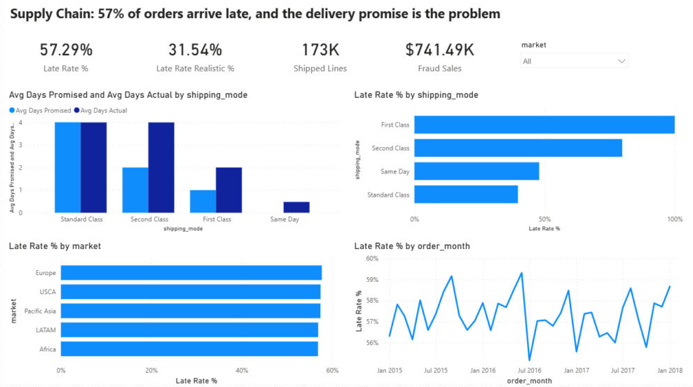
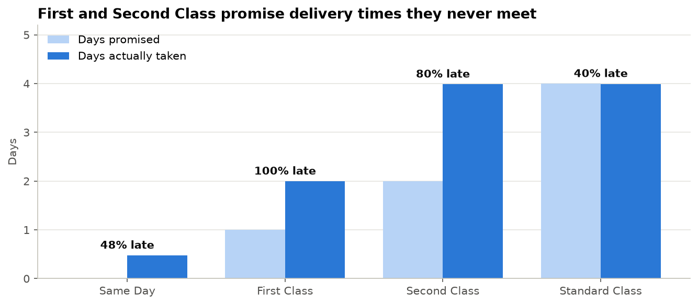
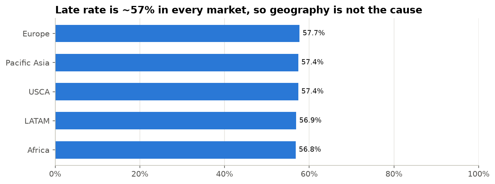
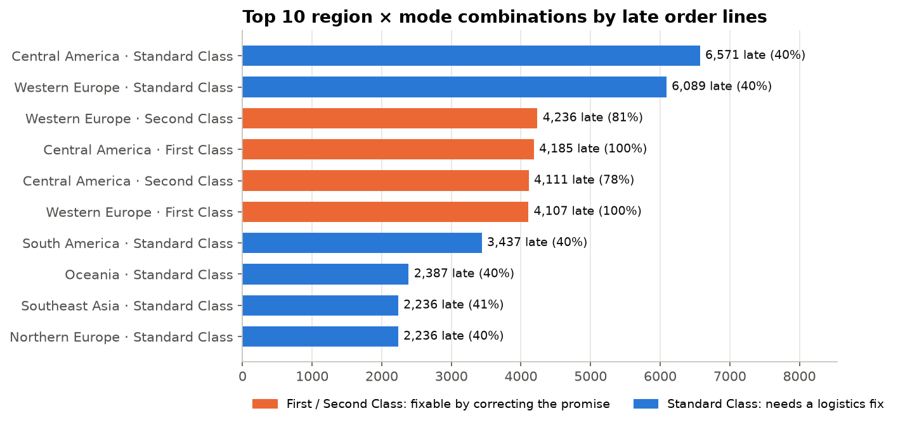
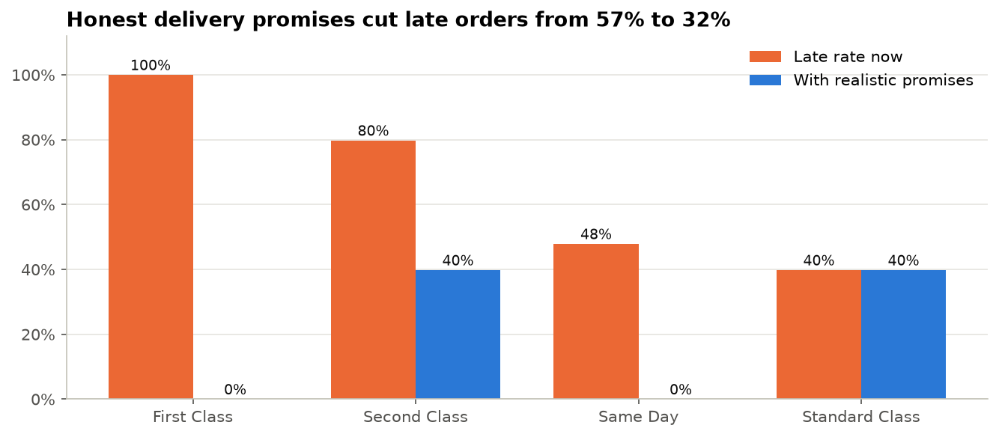
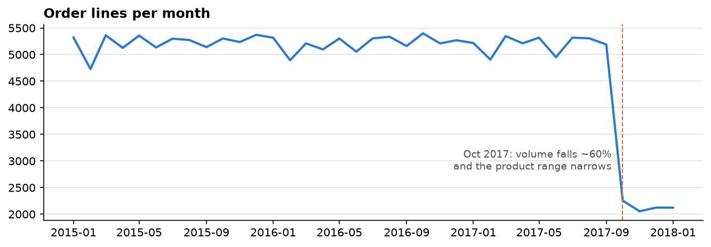

# Supply Chain Delivery Risk: Why 57% of Orders Arrive Late

**SQL (DuckDB) · Python (pandas, matplotlib) · Power BI**

A global sporting-goods retailer (DataCo) ships **57% of its order lines late**. This project finds the root cause, ranks where to act first, and sizes the fix.

> **Key finding:** lateness is not a regional or warehouse problem. It is caused by **delivery promises the business can't keep**. First Class promises 1 day but always takes 2 (100% late), and Second Class promises 2 days but averages 4 (80% late). Setting honest promises would cut late orders from **57% to 32%** with no logistics spend.



---

## Business questions

| # | Question | Answer in one line |
|---|---|---|
| 1 | How big is the late-delivery problem? | 57% of shipped lines (~99k) arrive after the promised date |
| 2 | Which shipping modes cause it? | First Class 100% late, Second Class 80%, Standard 40%, Same Day 48% |
| 3 | Is it regional, product or customer-driven? | No: every market is 57–58% late, but by mode it ranges from 40% to 100% |
| 4 | Where to act first? | 10 region × mode pairs (out of ~90) hold 40% of late lines, led by Central America and Western Europe |
| 5 | Does lateness cost profit? | Not per order (late ≈ on-time profit). The real margin leak is ~19% of lines selling at a loss |
| 6 | Where is fraud risk? | 100% of suspected fraud is bank-transfer payments (8.1% of transfers) |
| 7 | What if promises matched reality? | Late rate falls from **57% to 32%** |

## Results

### The promise is the problem


### Geography is not the cause


### Where to act first


### What honest promises are worth


## Recommendations

1. **Re-set checkout promises** for First Class (1 → 2 days) and Second Class (2 → 4 days). It's a policy change that removes about 25 percentage points of late orders.
2. **For genuinely faster delivery**, investigate the 2–6 day spread in Second and Standard Class, starting with **Central America and Western Europe**.
3. **Don't fund region-specific logistics fixes.** Regions perform almost identically.
4. **Add verification for bank-transfer payments**, where all suspected fraud sits.
5. **Open a pricing review** of loss-making order lines (~19% of lines, about $3.9M lost).

---

## Approach

```
Raw CSV (Windows-1252) ──► 01 Data quality & cleaning (SQL) ──► clean Parquet/CSV ──► 02 Analysis (SQL + Python) ──► Findings
                                                                    │
                                                                    └──► Power BI dashboard
```

### Data quality: issues found and fixed
| Issue | How it was found | Fix |
|---|---|---|
| File isn't UTF-8: it is **Windows-1252** (not Latin-1, as bytes `0x8A/0x8E/0x92` prove) | Default read fails; byte scan | Converted to UTF-8 before loading |
| Masked emails and passwords; names and street addresses | Distinct-value check | Dropped (no value; data minimisation) |
| `Product Description` 100% empty, `Order Zipcode` 86% empty | Null profile | Dropped |
| 5 pairs of duplicate columns | Row-by-row comparison (0 differences) | Kept one of each |
| Cancelled shipments carry "days" values | Late flag vs actual-vs-promised check | `is_cancelled` flag, excluded from delivery metrics |
| Volume falls ~60% and categories narrow from Oct 2017 | Monthly profile | Kept, flagged; trends not read across the break |

The late flag was **validated**: for every shipped line it equals *actual days > promised days*.



### SQL techniques used
CTEs · window functions (`RANK`, running `SUM() OVER`) with `QUALIFY` · `FILTER` aggregates · `VALUES` lookup tables for scenarios · `UNION ALL` comparisons. The key queries are in [`sql/analysis_queries.sql`](sql/analysis_queries.sql).

### Dashboard
A one-page Power BI report ([`dashboard/supply_chain_risk.pbix`](dashboard/supply_chain_risk.pbix)) with KPI cards (late rate now vs with realistic promises, shipped lines, suspected-fraud sales), promised vs actual days, late rate by shipping mode and by market, a monthly late-rate trend and a market slicer. Key DAX: `Late Rate % = CALCULATE(AVERAGE(orders[is_late]), orders[is_cancelled] = FALSE())`, and a `SWITCH`-based measure that recalculates lateness against realistic promises (31.5%, matching notebook 02).

## Repository structure
```
├── data/
│   ├── raw/                  # Kaggle file (not committed, ~95 MB)
│   └── processed/            # supply_chain_clean.parquet (CSV copy is git-ignored)
├── notebooks/
│   ├── 01_data_quality_and_cleaning.ipynb
│   └── 02_delivery_risk_analysis.ipynb
├── sql/analysis_queries.sql
├── dashboard/                # Power BI report
├── images/
└── requirements.txt
```

## How to run
```bash
python -m venv venv
venv\Scripts\activate          # Windows  (macOS/Linux: source venv/bin/activate)
pip install -r requirements.txt
```
1. Download `DataCoSupplyChainDataset.csv` from [Kaggle](https://www.kaggle.com/datasets/shashwatwork/dataco-smart-supply-chain-for-big-data-analysis) into `data/raw/`.
2. Run `notebooks/01_data_quality_and_cleaning.ipynb`, then `02_delivery_risk_analysis.ipynb`.

## Data
DataCo Smart Supply Chain (Kaggle): 180,519 order lines, 65,752 orders, Jan 2015 to Jan 2018, 5 markets and 23 regions. It's a public dataset, used here to demonstrate an end-to-end analytical workflow.
